  

  
  
  
  

Sou responsável técnico pelas **35 aplicações internas** do Grupo Bononi e da Stonni. Cuido de ponta a ponta: arquitetura, banco de dados, integrações, publicação e manutenção em produção.

O objetivo é sempre o mesmo: **tirar trabalho manual da operação e entregar números em que dá pra confiar.**

  

## No Grupo Bononi

  

Ver em texto

- **Operação:** expedição com separação, conferência e romaneio direto no coletor Android, além de compras, cobrança, frete, RH, treinamento e loja física.
- **Integração de dados:** replicação do ERP para a nuvem e integrações com Bling, marketplaces e transportadoras, incluindo cotação de frete e auditoria de CT-e.
- **Dashboards:** painéis financeiros e comerciais construídos direto sobre SQL.
- **Canais de venda:** loja própria com painel administrativo, portal do representante, CRM de atacado e portal da rede de assistência técnica da Stonni.
- **Infraestrutura:** migrations, controle de acesso por módulo, Edge Functions, rotinas agendadas e deploy contínuo.

## Como eu trabalho

> [!TIP]
> Desenvolvo com **Claude Code** em todo o ciclo: planejamento, implementação, revisão de código, migrations e auditoria do banco. É assim que 35 aplicações seguem em produção com uma equipe enxuta.

Nada vai para produção validado só por build verde:

| 🔎 Dado real | ✅ Commit revisado | 🔁 Replicado e testado |
|:--|:--|:--|
| Cada entrega é conferida com dado de verdade. | Toda mudança vira um commit revisado. | Quando afeta vários sistemas, é replicada e testada em cada um. |

## Projetos próprios

  
  

## Tecnologias

  

## No GitHub

  
  

  <picture>
    <source media="(prefers-color-scheme: dark)" srcset="https://raw.githubusercontent.com/GustavoPelissari/GustavoPelissari/output/github-snake-dark.svg">
    <source media="(prefers-color-scheme: light)" srcset="https://raw.githubusercontent.com/GustavoPelissari/GustavoPelissari/output/github-snake.svg">
    
  </picture>

## Formação

🎓 Tecnologia em Sistemas para Internet, UniALFA, Umuarama (conclusão em 2026).

## Contato

[gustavopelissari.com.br](https://gustavopelissari.com.br) · [Instagram @gustavopelissaridev](https://www.instagram.com/gustavopelissaridev)

  

As aplicações do Grupo Bononi e da Stonni ficam em repositórios privados da empresa. As artes de `assets/` são geradas por `ferramentas/gerar_svgs.py`.
